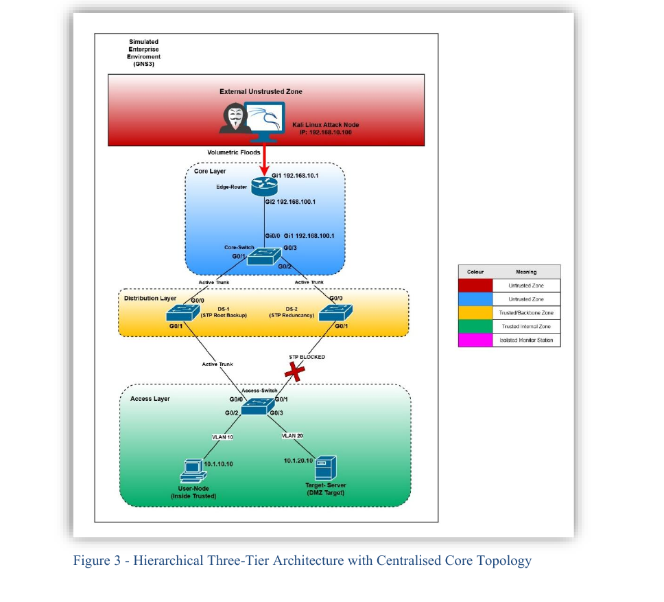

# Stateful vs. Stateless Defence: Comparing DoS Mitigation on Cisco IOS-XE

A hands-on network security research project comparing two Denial-of-Service (DoS) mitigation strategies — stateless **Control Plane Policing (CoPP)** and stateful **Zone-Based Firewall (ZBF)** — in a virtualised enterprise network built from scratch.

> **BSc (Hons) Computer Networking & Cyber Security — First-Class Honours**
> London Metropolitan University · Final-year dissertation project (CS6P05)

---

## TL;DR

I designed and built a full three-tier enterprise network in GNS3 using real Cisco IOS-XE devices, launched real DoS attacks against it from a Kali Linux node, and measured how two different defences performed. The headline finding:

- An **unmitigated TCP SYN flood** collapsed legitimate traffic and caused **7.1 million packet drops** while the router CPU still read **0%** — proving CPU monitoring alone misses data-plane exhaustion.
- **Zone-Based Firewall (ZBF)** restored full service at a measurable cost of **0.31% CPU**.
- **Control Plane Policing (CoPP)** absorbed an attack ~122× its configured rate limit with **no measurable CPU overhead**.
- **Conclusion:** the two defences solve different problems — a layered, defence-in-depth design needs both.

---

## What this project demonstrates

| Area | Skills shown |
|------|--------------|
| **Networking** | VLANs, inter-VLAN routing (SVIs), 802.1Q trunking, Rapid PVST+ spanning tree, static routing, three-tier hierarchical design |
| **Security** | DoS attack analysis, Control Plane Policing (CoPP), Zone-Based Firewall (ZBF), defence-in-depth |
| **Tools** | GNS3, Cisco IOS-XE CLI, Kali Linux, hping3, iperf3, Wireshark, Tailscale/WireGuard, Ubuntu Server |
| **Method** | Controlled experiment design, baseline benchmarking, empirical measurement, structured troubleshooting, technical documentation |

---

## The network

A **hierarchical three-tier architecture with centralised core routing**, built in GNS3 on a dedicated Ubuntu server and accessed securely over a Tailscale (WireGuard) zero-trust overlay.



**Layers**
- **Core layer** — Core Switch does all inter-VLAN routing via SVIs and acts as STP primary root. Edge Router is the WAN boundary where the security policies live.
- **Distribution layer** — two switches (DS-1, DS-2) for redundancy, running Rapid PVST+ for a loop-free topology.
- **Access layer** — segments endpoints into VLAN 10 (User) and VLAN 20 (DMZ Target Server).
- **External untrusted zone** — a Kali Linux node that launches the attacks.

**Addressing** (private/lab ranges only)

| Device | Interface / VLAN | IP |
|--------|------------------|-----|
| Attacker (Kali) | eth0 | 192.168.10.100 |
| Edge Router | Gi1 (Outside) | 192.168.10.1 |
| Edge Router | Gi2 (Transit) | 192.168.100.1 |
| Core Switch | Gi0/0 (Transit) | 192.168.100.2 |
| Core Switch | VLAN 10 (SVI) | 10.1.10.1 |
| Core Switch | VLAN 20 (SVI) | 10.1.20.1 |
| User-Node | VLAN 10 | 10.1.10.10 |
| Target-Server | VLAN 20 | 10.1.20.10 |

---

## The experiment

Five paired conditions, each measured with the same tools, so the effect of each defence is isolated:

| # | Condition | CPU (5s avg) | Legitimate throughput (iperf3) | Outcome |
|---|-----------|--------------|-------------------------------|---------|
| 1 | Baseline (no attack) | 0% | 943 Kbps | Reference state, 0% loss, 4.7 ms RTT |
| 2 | ICMP flood, unmitigated | 0% | 943 Kbps | Absorbed at interrupt level; control plane untouched |
| 3 | SYN flood, unmitigated | 0% | ≈0 (collapse) | **Data-plane exhaustion: 7,112,469 output drops** |
| 4 | ICMP flood + CoPP | 0% | 943 Kbps | Stateless rate-limit holds the line at ~zero CPU cost |
| 5 | SYN flood + ZBF | 0.31% | 944 Kbps | Stateful inspection restores throughput at a small CPU cost |

**Attack generation (Kali, hping3)**
```bash
# Volumetric ICMP flood — targets the router control plane
sudo hping3 --icmp --flood 192.168.10.1

# TCP SYN flood — targets the downstream server (data plane)
sudo hping3 -S --flood -p 5201 10.1.20.10
```

**Measurement (Cisco IOS-XE + Linux)**
```bash
show processes cpu sorted | exclude 0.00   # control-plane CPU
show interfaces gi1 | include drops          # data-plane queue exhaustion
show policy-map control-plane                # CoPP conform/exceed/drop counters
iperf3 -c 10.1.20.10 -t 10                    # legitimate throughput
```

---

## Key findings

**1. CPU monitoring alone is not enough.** The unmitigated SYN flood destroyed legitimate throughput and produced 7.1M output drops, yet CPU stayed at 0%. The damage was on the data plane, invisible to control-plane CPU monitoring.

**2. CoPP is a near-free shield for the control plane.** A token-bucket rate limit of 8,000 bps absorbed ~978,000 bps of ICMP flood (≈122× its ceiling) with no measurable CPU cost — but it only protects the control plane.

**3. ZBF restores service for the data plane, at a cost.** Stateful inspection brought legitimate throughput back to baseline (944 Kbps) during the SYN flood, for a measurable 0.31% CPU increase from tracking connection state.

**4. Defence-in-depth is the answer.** Each mechanism covers a failure the other cannot. The data supports deploying CoPP as a permanent control-plane shield and ZBF where stateful data-plane inspection is justified.

---

## Mitigation configs (the real thing)

**CoPP — stateless, control plane**
```
access-list 100 permit icmp any any
class-map match-all ICMP-CLASS
 match access-group 100
policy-map COPP-POLICY
 class ICMP-CLASS
  police 8000 conform-action transmit exceed-action drop
control-plane
 service-policy input COPP-POLICY
```

**ZBF — stateful, data plane**
```
zone security OUTSIDE
zone security INSIDE
interface GigabitEthernet1
 zone-member security OUTSIDE
interface GigabitEthernet2
 zone-member security INSIDE
```

Full device configurations are in [`/configs`](configs/).

---

## Repository structure

```
.
├── README.md                     # this file
├── configs/                      # real Cisco IOS-XE device configs
│   ├── core-switch.txt
│   ├── distribution-ds1.txt
│   ├── access-switch.txt
│   ├── edge-router.txt
│   ├── mitigation-copp.txt
│   └── mitigation-zbf.txt
├── docs/
│   └── topology.png              # network diagram
└── Full_Dissertation.pdf         # complete academic report (optional deep dive)
```

---

## Ethical & legal note

All offensive testing was carried out inside a fully isolated virtual lab. No attack traffic ever reached the public internet. The work complies with the **UK Computer Misuse Act 1990** and the **BCS Code of Conduct**.

---

## About

Built by **Alberto Novas** as the final-year project for BSc (Hons) Computer Networking & Cyber Security (First-Class Honours), London Metropolitan University.

📫 Open to entry-level roles in IT support, networking and cyber security.
